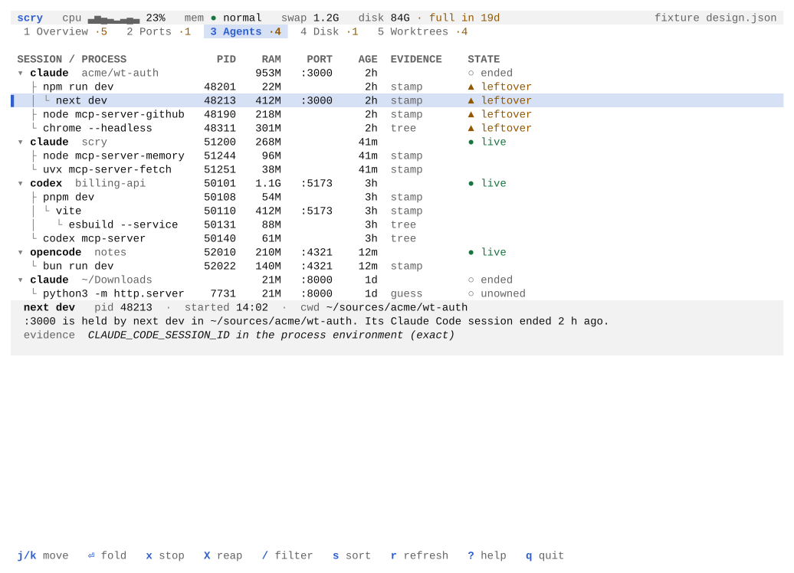
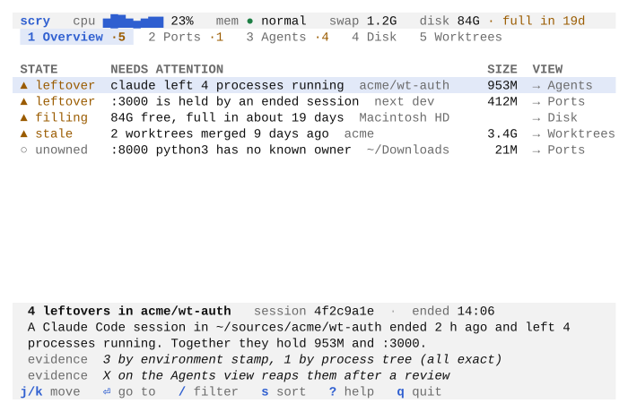
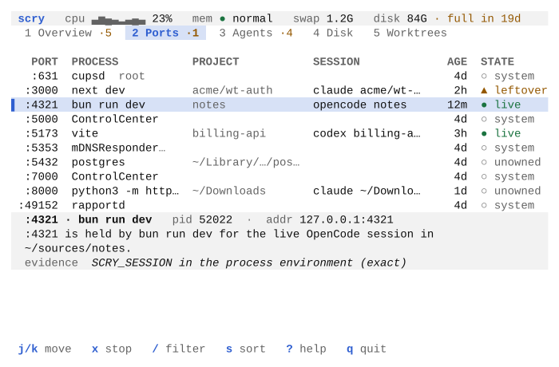
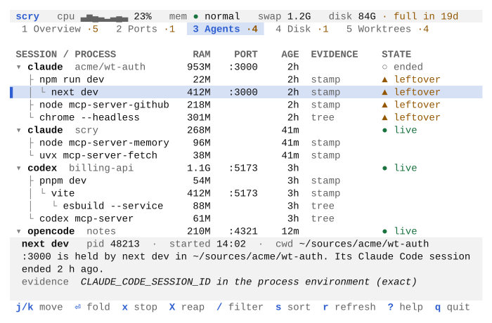
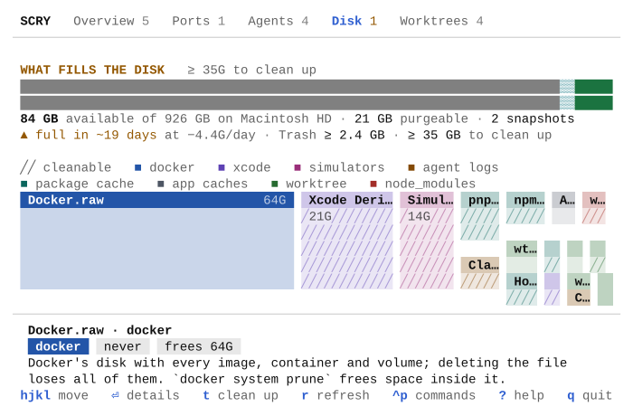
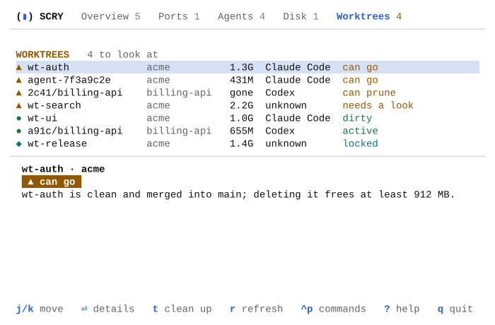
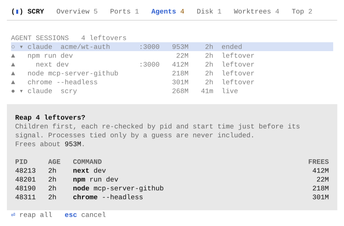

<p align="center">
  <picture>
    <source media="(prefers-color-scheme: dark)" srcset="docs/logo/scry-dark.svg">
    
  </picture>
</p>

# Scry

**See what your coding agents left running on your Mac.**

Scry is a system monitor for macOS that traces every process, port, git worktree and
gigabyte back to the project and the agent session that made it. It runs in your terminal,
and every view is also a command with `--json` output for scripts and agents.

<picture>
  <source media="(prefers-color-scheme: dark)" srcset="docs/screens/agents-dark-120x40.svg">
  
</picture>

## Why

Coding agents such as Claude Code, Codex, OpenCode and Gemini CLI start dev servers, MCP
servers and headless browsers, create git worktrees and fill caches. When a session ends,
much of that stays behind:

- a dev server still holds `:3000`, so the next one starts on `:3001`;
- a few hundred megabytes of node processes keep running with nobody to talk to;
- a worktree from last week's branch sits on disk long after it was merged;
- caches and `node_modules` folders grow until the disk is full.

Activity Monitor and `lsof` show you the processes, but not who started them or whether
anything still needs them. Scry answers that, shows its evidence for each answer, and lets
you clean up after a confirmation that lists exactly what will happen.

> **Status:** version 0.1, the first public release. Scry runs on macOS 14 or later on
> Apple Silicon, and Linux support is next on the [roadmap](docs/roadmap.md#linux). See the
> [changelog](CHANGELOG.md).

## Install

You need [Rust](https://rustup.rs) 1.89 or later and the Xcode Command Line Tools
(`xcode-select --install`).

```sh
git clone https://github.com/morozRed/scry.git
cd scry
cargo install --path crates/scry
```

This puts `scry` in `~/.cargo/bin`. A Homebrew formula is ready in
[`packaging/homebrew`](packaging/homebrew/scry.rb) and will be published with the first
tagged release.

Scry needs no root access and no special permissions.

## Quick start

```sh
scry                  # open the terminal UI
scry overview         # print what needs attention and exit
scry doctor           # check that Scry can work on this Mac
```

Optional, for full history (both are explained below):

```sh
scry daemon install          # record disk history and agent process trees in the background
scry hook install claude     # tell Scry exactly when Claude Code sessions start and end
scry setup                   # teach your coding agents to use Scry's CLI
```

To try Scry without touching your real setup, set `SCRY_HOME` to an empty folder. The
config and all data then live in that folder.

```sh
SCRY_HOME=/tmp/scry-try scry
```

## A tour of the terminal UI

Press `1` to `5` or `tab` to switch views, `j`/`k` or the arrow keys to move, `/` to
filter, `s` to sort and `?` for every key. `ctrl-p` (or `:`) finds any command by name, and
the mouse works too: click a view or a row, scroll with the wheel. The pane beside each list
(under it below 100 columns) explains the selected row in one sentence, with its details
and evidence; `enter` opens it over the whole screen.

### 1 Overview

<picture>
  <source media="(prefers-color-scheme: dark)" srcset="docs/screens/overview-dark-80x24.svg">
  
</picture>

Gauges for CPU, memory and the disk, then one ranked list of what needs attention across
all views. `Enter` jumps to the row it is about. When nothing needs attention, it says so.

### 2 Ports

<picture>
  <source media="(prefers-color-scheme: dark)" srcset="docs/screens/ports-dark-80x24.svg">
  
</picture>

Every listening port on the Mac, yours and the system's, with the process, project and
agent session behind it. `x` stops the selected process.

### 3 Agents

<picture>
  <source media="(prefers-color-scheme: dark)" srcset="docs/screens/agents-dark-80x24.svg">
  
</picture>

Agent sessions as a tree, each with the processes it started, their ports, RAM and age, and
in the pane the evidence that ties them to the session. `space` folds a session. Processes left running after their session ended
are flagged as **leftovers**. `X` stops them all after a confirmation, and `K` puts one on
your keep list so Scry never selects it again.

### 4 Disk

<picture>
  <source media="(prefers-color-scheme: dark)" srcset="docs/screens/disk-dark-80x24.svg">
  
</picture>

Free space as Finder counts it, a forecast of when it runs out, and the caches, simulator
data, `node_modules` folders and worktrees that fill it, as a treemap sized by what each
takes and coloured by kind, with what Scry can clean up hatched. The arrow keys move between
tiles; `v` switches to a list ranked by what deleting each would free. `t` cleans up the
selected item in the one way it allows.

### 5 Worktrees

<picture>
  <source media="(prefers-color-scheme: dark)" srcset="docs/screens/worktrees-dark-80x24.svg">
  
</picture>

Every linked git worktree under your code roots, with its state, size and the agent that
probably made it. A worktree is "can go" only when removing it loses nothing and its work is
merged or pushed.

Scry follows your terminal's light or dark theme and honours `NO_COLOR`. It needs a
terminal of at least 80×24. These screens are drawn from a synthetic fixture, so every
name in them is made up; [docs/design.md](docs/design.md) explains how the look was chosen.

## The CLI

Every view is also a command. Each prints plain text by default and JSON with `--json`.
Run without a terminal, as an agent does, bare `scry` prints the Overview instead of
opening the UI, so it never hangs a script.

| Command | What it does |
|---|---|
| `scry overview` | What needs attention, ranked |
| `scry ports` | Every listening port with its process, owner, project and age |
| `scry why <port>` | Who holds a port, in one sentence, with the evidence |
| `scry stop <pid>` or `scry stop :<port>` | Stop one of your processes, after you confirm |
| `scry agents [--tree]` | Agent sessions, and with `--tree` the processes each one started |
| `scry leftovers` | Processes left running by sessions that ended, with the evidence |
| `scry reap` | Stop the leftovers, children first, after you confirm |
| `scry keep <pid>` | Add a process to the keep list, so no rule selects it again |
| `scry worktrees` | Linked worktrees with state, size and probable creator |
| `scry disk` | Free space, the forecast and the largest items |
| `scry clean <item>` | Clean up one item from `scry disk` |
| `scry watch --json` | Every view as one JSON line now, and another each time it changes |
| `scry snapshot` | A redacted JSON snapshot of this machine, for bug reports |
| `scry doctor` | Check that Scry can work on this Mac, with a fix for each problem |

`scry <command> --help` lists every option. For example:

```console
$ scry why 3000
:3000 is held by `next dev` in ~/acme/wt-auth, started 2h ago. It runs under Claude Code session 7f3a9c2e.

Evidence:
  - tcp4 127.0.0.1.3000 LISTEN in the kernel socket table, last used by pid 1320.
  - tcp6 ::1.3000 LISTEN in the kernel socket table, last used by pid 1320.
  - pid 1320 is `next dev`, started 2h ago.
  - Working directory ~/acme/wt-auth.
  - ~/acme/wt-auth is the project root: it holds .git.
  - CLAUDE_CODE_SESSION_ID=7f3a9c2e in the process environment.
```

More examples:

```sh
scry ports --json
scry why :3000 --json
scry stop :3000                  # asks before it sends SIGTERM
scry stop 4821 --yes --kill      # no prompt; SIGKILL if SIGTERM is not enough
scry leftovers --json
scry reap --dry-run              # what reap would stop; signals nothing
scry reap --session 4f2c9a1e     # one session's leftovers, by id or a unique prefix
scry disk --top 40 --json
scry clean npm-cache             # delete a cache after you type its name
scry clean worktree:~/sources/acme-wt-old --yes
```

### For scripts and agents

Agents use Scry through the CLI; there is no MCP server. An agent can run
`scry why 3000 --json` before it starts a dev server, or `scry leftovers --json` at the end
of a session. Actions take `--yes` instead of a prompt, and refusals come back as JSON too.

`scry setup` teaches an agent all of this. It installs a skill, a `SKILL.md` that tells the
agent when to reach for Scry, which command answers which question, and the rules: look
before acting, act only after you agree, never touch a process tied by a guess. Claude Code,
Codex, OpenCode and Gemini CLI read the same skill, each from its own folder.

```sh
scry setup                      # pick agents from a list; enter takes every agent found
scry setup claude codex         # or name them: claude, codex, opencode, gemini
scry setup --all --dry-run      # what it would write for every agent found
scry setup --remove --all       # take Scry's skill out again
scry setup --print              # read the skill first
```

A skill named `scry` that Scry did not write is left alone, and `--remove` removes only
Scry's own. A new session of the agent loads the skill.

`scry stop` and `scry reap` exit `0` when the processes stopped, `1` when nothing was
signalled and `2` when one is still running. `scry clean` exits `0` when done and `1` when
it was refused or stopped partway. Every command exits `64` when its arguments are wrong.

`scry watch --json` streams every view as one JSON line per change, for programs that want
to follow along.

## How Scry ties a process to a session

Scry recognises Claude Code, Codex, OpenCode and Gemini CLI by their executable path. A
process belongs to a session by one of three kinds of evidence:

- **stamp** (exact): its environment carries the session id, such as
  `CLAUDE_CODE_SESSION_ID`, `CODEX_SESSION_ID`, or `SCRY_SESSION` from Scry's own hook;
- **tree** (exact): it descends from the agent process, now or as the background recorder
  saw it before the agent exited;
- **guess** (shown, never acted on): it started in the session's folder while the session
  ran.

A process is a **leftover** only when a stamp or the tree ties it to a session, every
session that claims it has ended, it is not on the built-in never-reap list (agent daemons,
terminal multiplexers, `ssh-agent`, app helpers and others), neither it nor anything below
it has a terminal, it is older than five minutes, and it is not on your keep list.

Scry cannot tell abandoned work from a job you meant to outlive its session, such as one
started with `nohup`. Add such a job to the keep list. [docs/architecture.md](docs/architecture.md)
has the full rules.

## Safety

Scry is built to be safe to point at a busy machine.

<picture>
  <source media="(prefers-color-scheme: dark)" srcset="docs/screens/sheet-dark-80x24.svg">
  
</picture>

**What Scry never does**

- It never acts on one key or without asking. Every action opens a confirmation sheet in
  the UI, or a prompt in the CLI, that lists each target and what it frees. Scripts must
  pass `--yes`, and a permanent delete also needs the item's name with `--confirm`.
- It never signals another user's process or a system one: not pids below 100, not
  launchd, not anything that runs from `/System/`, `/usr/libexec/`, `/usr/sbin/` or `/sbin/`.
- It never reaps a process tied to a session only by a guess, or one on your keep list.
- It never sends SIGKILL first. Stop and reap send SIGTERM and wait 3 seconds; SIGKILL
  follows only with `--kill`, or a second confirmation in the UI.
- It never looks inside Desktop, Documents or Downloads, and never removes your home
  folder, those folders, its own config and data, or any folder above one of them.
- It never runs `git fetch` or `git worktree prune`. The one change it makes inside a
  repository is **prune**, which removes the record of a single worktree whose folder is
  already gone, after you confirm.
- It never runs a cleanup command for you. For items such as Docker or simulators it shows
  the tool's own command for you to run.

**What it checks right before acting.** Just before each signal, Scry reads the config and
the process again and checks that it is still the same process (by pid and start time),
still yours, and for a reap still a leftover of the same session. Just before a cleanup, it
checks again that the folder is the one it showed you and holds no repository, other
worktree or mounted volume, opening it without following symlinks.

**Turn it all off.** `destructive = false` in the config refuses every stop, reap and
cleanup, naming the line that does it. It takes effect even while a confirmation is open.
Adding to the keep list stays allowed, since it only ever spares processes.

**Trash first.** Worktrees and anything that cannot be rebuilt go to the Trash, so Put Back
in Finder restores them. Only caches that their tool fills again can be deleted for good.

**Audit log.** Every action writes what it is about to do to the `audit` table in Scry's
store before it acts, and nothing happens when that row cannot be written. Cleanups also
record what happened, including exactly what changed if they stopped partway. To read it:

```sh
sqlite3 ~/Library/Application\ Support/Scry/scry.db 'select * from audit order by id desc limit 20'
```

## The background recorder

Some answers need something running while Scry is closed: disk history for the forecast,
and which session each process belonged to before its agent exited. A small daemon records
both.

```sh
scry daemon install     # install the LaunchAgent and start the daemon
scry daemon status      # installed, running, and how fresh the samples are
scry daemon uninstall   # stop it and remove the LaunchAgent; the data stays
```

It samples free space every 10 minutes, takes hook events, and watches running agents so it
can record their process trees as they change. Everything else works without it. It uses
about 16 MB of memory, and its scans run at macOS's utility priority, so your own work
comes first; see [Performance](#performance).

`install` writes `~/Library/LaunchAgents/com.morozred.scry.daemon.plist`. macOS then shows
a "Background Items Added" notice, and Scry appears under System Settings > General > Login
Items & Extensions. Run `install` again after you upgrade Scry or change the config: it
restarts the daemon when either changed, and `scry daemon status` says when that is needed.

## Claude Code hooks

```sh
scry hook install claude     # shows the diff and backs up the file first
scry hook uninstall claude   # removes Scry's hooks and nothing else
```

This adds SessionStart and SessionEnd hooks to `~/.claude/settings.json` (or
`$CLAUDE_CONFIG_DIR/settings.json`), so Scry knows exactly when each session starts and
ends. The hook prints nothing, always exits 0 and appends one line to Scry's spool. Install
keeps every other hook and the file's formatting, and refuses when Claude Code's managed
settings would block user hooks or when Claude Code is older than 2.1.139. Codex and Gemini
CLI sessions are tracked by stamp and process tree; hooks for them are planned.

## Configuration

The config file is `~/.config/scry/config.toml`. It is optional, and so is every key. These
are the defaults:

```toml
# Where your projects and worktrees live. Default: whichever of
# ~/sources, ~/code, ~/src and ~/Developer exist.
code_roots = ["~/sources", "~/code", "~/src", "~/Developer"]

# false refuses every stop, reap and cleanup. Keeping a process stays allowed.
destructive = true

# Processes no rule ever selects: a name, an executable path, a script path,
# or "<script> in <dir>". `K` in the UI and `scry keep <pid>` add entries for you.
keep = []

# How old a process must be before it can be a leftover, 0 to 604800 seconds.
leftover_grace_secs = 300

[daemon]
# How often the daemon samples free space, in seconds (at least 1).
sample_interval_secs = 600

[tui]
# Seconds between live refreshes, 1 to 60. 0 refreshes only when you press r.
refresh_secs = 5
```

A mistake in the file is an error that names the line. `scry keep` edits only the `keep`
list and leaves comments and formatting alone.

Environment variables:

| Variable | Effect |
|---|---|
| `SCRY_HOME=<dir>` | Keep the config in `<dir>/config.toml` and the data in `<dir>/state/`. The LaunchAgent gets its own label, so a test install never touches the real one. |
| `NO_COLOR` | No colour: bold, dim and reverse video only. Every state is still a word and a glyph. |
| `SCRY_COLOR_QUERY=1` or `0` | Always or never ask the terminal for its colours. By default Scry asks only local terminals known to answer at once. |
| `CLAUDE_CONFIG_DIR` | Where `scry hook` finds Claude Code's `settings.json`. |

## Privacy

Scry runs entirely on your Mac. **It has no network code and sends nothing anywhere.**

**What it reads**

- The process table and the kernel's socket table, for all users, as `ps` and `netstat`
  can.
- For your own processes only: their arguments, working directory and environment.
- Folder sizes in a fixed catalog of developer caches and under your code roots.
- `git status` and git's own records for each worktree under your code roots.
- Claude Code's `settings.json`, only when you install or remove the hooks.

**What it never keeps or shows**

- **No raw command lines.** Scry shows a *command label* such as `next dev --port 3000`,
  built only from parts known to be safe: the program, a fixed list of subcommand words,
  flag names but never their values, the last part of an existing file path, and port
  numbers the process itself listens on. Everything else becomes `…`, so passwords and
  tokens passed as arguments stay out of tables, `--json` and snapshots. The full command
  line prints only with `scry why <port> --show-command`, as text, and never in JSON.
- **No environment values** beyond the few session-id keys listed above. The rest is dropped
  in memory.
- **No telemetry.**

**What it stores**, in `~/Library/Application Support/Scry/`, a folder only you can open:
disk-space samples, agent sessions and the processes tied to them (pid, start time,
working directory), cached folder sizes, the audit log, and the daemon's log. Nothing
leaves this folder. `scry snapshot` writes your home folder as `~` and replaces your account
name, so you can attach it to a bug report after reading it through.

## Performance

Measured on an M-series MacBook with about 1,100 processes, release build:

| What | CPU | Memory |
|---|---|---|
| `scry` open, idle on any view (a reading every 5 s) | under 1% of one core | about 20 MB |
| Opening Disk, while it measures folder sizes | about half a core for 15 to 20 s, then idle | up to 75 MB, back to about 30 MB |
| The background recorder, while an agent runs commands | about 1% of one core | about 16 MB |
| The background recorder, with no agent working | one scan every 30 s | about 16 MB |

A full scan of the process table and sockets takes about 25 ms; `scry bench scan` measures
it on your Mac. The folder walks and the recorder run at macOS's utility priority, so they
give way to what you are doing.

## Requirements

- macOS 14 or later on Apple Silicon. Linux is planned: see the
  [roadmap](docs/roadmap.md#linux)
- To build: Rust 1.89 or later and the Xcode Command Line Tools
- Optional: `git` on your `PATH` for the Worktrees view (the Command Line Tools include it)

## Documentation

- [docs/architecture.md](docs/architecture.md): how the code is organised and how
  attribution, leftovers and safe cleanup work
- [docs/design.md](docs/design.md): how the terminal UI looks, and why
- [docs/roadmap.md](docs/roadmap.md): what 0.1 includes and what comes next
- [CHANGELOG.md](CHANGELOG.md)

## Contributing

Bug reports and pull requests are welcome. [CONTRIBUTING.md](CONTRIBUTING.md) covers how
to build, test and send a change.

## License

[MIT](LICENSE)
