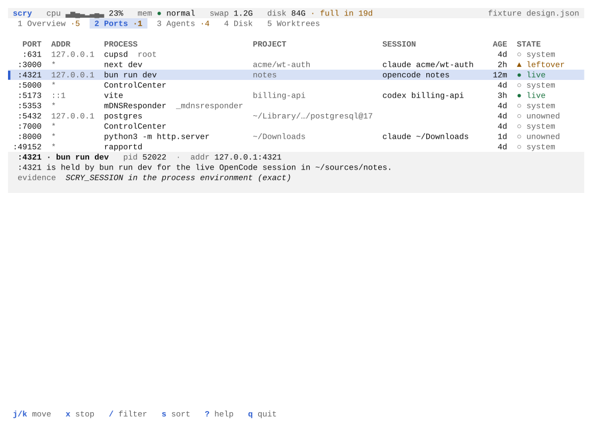
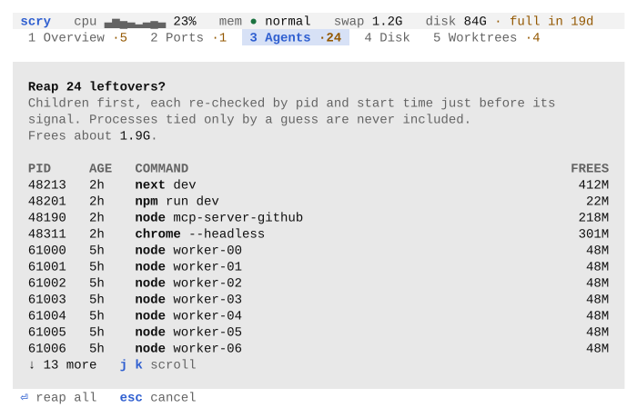
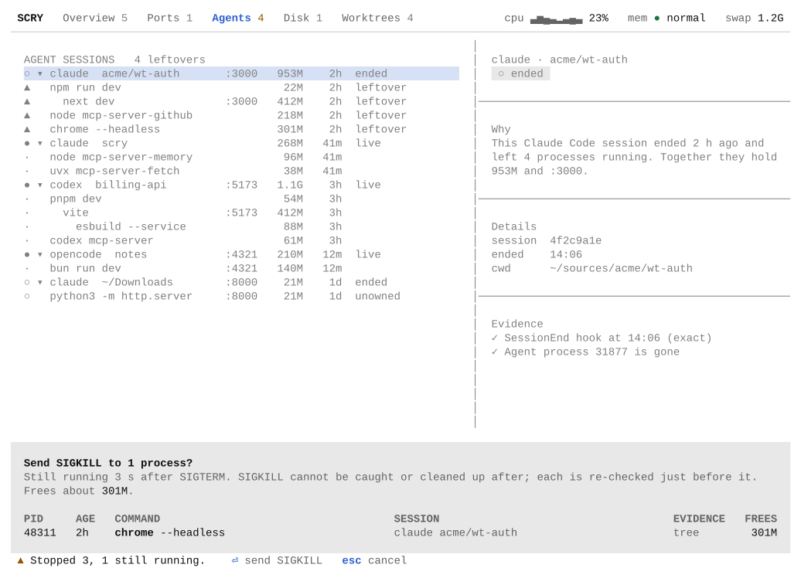

# Scry

Scry shows which agent session left each process, port, worktree and gigabyte on
your Mac.

Coding agents such as Claude Code and Codex start dev servers, MCP servers and
headless browsers, create worktrees and fill caches. When a session ends, much of
that stays behind. Scry traces each of these back to the project and the agent
session that made it, so you can see what is safe to stop or delete. An MCP server
that gives agents the same answers is planned.

> **Status:** early development. The process scan, the terminal UI shell and the
> `ports`, `why` and `stop` commands work. Agents, disk and worktrees are being
> built. See the [roadmap](PLAN.md).

## Screenshots

<picture>
  <source media="(prefers-color-scheme: dark)" srcset="docs/screens/agents-dark-120x40.svg">
  
</picture>

The Agents view groups processes under the agent session that started them and
flags what a finished session left behind. The pane below the list explains the
selected row in one sentence, with its evidence.

<picture>
  <source media="(prefers-color-scheme: dark)" srcset="docs/screens/ports-dark-120x40.svg">
  
</picture>

The Ports view lists every listening port on the Mac, yours and the system's.

<picture>
  <source media="(prefers-color-scheme: dark)" srcset="docs/screens/sheet-long-dark.svg">
  
</picture>

Nothing is stopped on one key. Every action opens a sheet that lists each target
and what it frees.

<picture>
  <source media="(prefers-color-scheme: dark)" srcset="docs/screens/sheet-done-dark-120x40.svg">
  
</picture>

After you confirm, the footer says what happened. Whatever outlived SIGTERM is
offered SIGKILL on a sheet of its own.

Scry follows your terminal's light or dark theme. These screens are drawn from a
synthetic fixture with `cargo run -p scry --example shots`; the Disk and Worktrees
views show sample data until those parts are built. The design notes are
in [docs/design.md](docs/design.md).

## Requirements

- macOS 14 or later on Apple Silicon
- Rust 1.90 or later to build

Scry needs no root access.

## Build and run

```sh
cargo install --path crates/scry
scry                 # open the terminal UI
scry overview        # print a summary and exit
scry overview --json
```

Run without a terminal, as an agent does, bare `scry` prints the summary instead of
opening the UI.

## Ports

```sh
scry ports                     # every listening port: process, owner, project, age
scry ports --json
scry why 3000                  # who holds :3000, in one sentence, with the evidence
scry why :3000 --json
scry why 3000 --show-command   # also print the full command line
scry stop :3000                # stop what holds :3000, after you confirm
scry stop 4821 --yes --kill    # by pid, no prompt, SIGKILL if SIGTERM is not enough
scry stop :3000 --json         # the outcome, or why nothing was stopped, as JSON
```

Scry names a process by a command label such as `next dev --port 3000` or
`docker exec … mysql …`. A label shows only:

- the program, or for an interpreter the script it runs from a `bin` directory, so
  `node …/.bin/next dev` reads `next dev`;
- subcommand words from a fixed list, such as `run`, `dev` and `serve`, unless they
  follow a flag;
- flag names, never their values, and `--`;
- the last part of an argument that names an existing file or directory on a local
  volume, with your home directory as `~`;
- the name of a program on your `PATH`;
- a number equal to a port the process itself holds open as a listener;
- for Python, the module after `-m`.

Anything else becomes `…`, whatever it holds, so passwords and tokens given as
values stay out of tables, `--json` and `scry snapshot`. A file, script or program
named like your account is left out too. A Python multiprocessing worker, such as
the server `uvicorn --reload` starts, is shown by the label of the process it works
for, marked as a worker. `scry snapshot` writes your home directory as `~` in paths
and replaces your account name anywhere else in them. `--show-command` prints the
full command line as text on request; it is never part of `--json`.

`scry stop` acts only on your own processes, never on system ones: not pids below
100, not launchd, not anything that runs from `/System/`, `/usr/libexec/`,
`/usr/sbin/` or `/sbin/`. Right before each signal, SIGKILL included, it reads the
config and the process again, writes a row saying what it is about to send to an
audit table in Scry's store, synced to disk, reads `destructive` once more, and
checks that the pid still belongs to the process it chose. When the row cannot be
written, nothing is sent. A process named by `:port` must still hold that port
before each signal: one that lets go of it after SIGTERM gets no SIGKILL, and the
report says why. It exits 0 when the
process stopped, 1 when nothing was signalled and 2 when the process is still
running. Every command exits 64 when its arguments are wrong. `destructive = false`
in the config refuses every stop and reap, naming the line, also when it is saved
while a confirmation waits or between two signals.

The pid check is as close to the signal as macOS allows. Scry watches the process
with kqueue before it checks anything, and asks the watch whether that process
exited or exec'd another program just before `kill(2)`, so a pid handed to another
process meanwhile, or a process that became something else while it was judged, is
never signalled. What is left is the few microseconds between that question and the
signal: the process would have to exit and macOS give its pid to a new one in that
time, which takes the pid counter going all the way round.

## Agents

```sh
scry agents                    # agent sessions running now, with project, RAM and ports
scry agents --tree --json      # each session with the processes it started
scry leftovers                 # what ended sessions left running, with the evidence
scry leftovers --json
scry reap --dry-run            # what reap would stop, children first; signals nothing
scry reap                      # stop the leftovers, after you confirm
scry reap --yes --json         # no prompt; each outcome, or why nothing was sent
scry reap --session 4f2c9a1e   # one session's: its id, or a start no other id has
scry keep 48213                # never select this process again; prints the change
scry watch --json              # one JSON line now and on every change, for programs
scry hook install claude       # exact Claude Code sessions; shows the diff, backs up
scry hook uninstall claude
```

Scry recognises Claude Code, Codex, OpenCode and Gemini CLI by their executable
path, in every install style it has seen (native installer, npm, the desktop apps,
Homebrew). A process belongs to a session by its environment stamp
(`CLAUDE_CODE_SESSION_ID`, `CODEX_SESSION_ID`, or `SCRY_SESSION` from Scry's own
hook), by a parent chain up to the agent, or, shown but never acted on, by having
started in the session's directory while it ran.

A process is a **leftover** only if all of these hold: a stamp or the process tree
ties it to a session, and a stamp counts only if the session had not ended before
the process started; every session that claims it has lost its agent process, and
an agent process that still runs counts as running even when Scry does not
recognise its executable; it is not on the never-reap list (`claude daemon`, Claude
Code's background pty hosts, `codex app-server`, `tmux`, `screen` and `zellij`,
`gpg-agent`, `keyboxd`, `scdaemon`, `dirmngr` and `ssh-agent`, ssh control masters,
and anything whose executable is inside an `*.app/Contents/` bundle except a
framework Python's interpreter, a file named `Python…` under `Python.framework/`)
and runs under nothing on that list; neither it nor anything below it has a
terminal; it is older than five minutes (`leftover_grace_secs` in the config); and
it is not on your keep list. An agent another agent started, such as a headless
Gemini that Claude Code ran, carries the outer session's stamp, so while it runs it
keeps that session's processes alive. A process re-parented to launchd that nothing
ties to a session is never a leftover. While the config cannot be read, nothing is
a leftover, and `scry leftovers` and `scry doctor` say why.

`scry reap` and `X` in the Agents and Overview views stop the leftovers, children
before their parents in the process tree, however deep. Right before each signal
Scry reads the config and the machine again, with nothing kept from the listing: its
arguments, environment stamps and role are read afresh, so a process that exec'd
into something else is judged as what it is now. It must still be a leftover of
the session it was listed under, not on the keep list, not a system process, and
still the same process by pid and start time, or it is skipped. After the audit row
is written, `destructive` and the keep list are read once more. Each gets SIGTERM
and up to 3 s to exit; the ones still running are reported, and SIGKILL follows
only with `--kill`, or after a second confirmation in the TUI, with the same
checks. The TUI's SIGKILL sheet lists exactly what outlived SIGTERM in the reap or
stop it follows, and nothing that finishes meanwhile changes it. `--session` takes
a session's full id, or a start of one that no other session's id has; given a
start that several share, it lists them and signals nothing. `reap` exits as
`stop` does.

`K` in the TUI and `scry keep <pid>` add a process to the keep list in the config,
after showing the whole change, and touch nothing else in the file. A program given
no file is kept by its executable's path (`~/bin/tunnel`). A script run by an
interpreter or shell (`node`, `python3`, `bash`, …) is kept by the script's real
path (`~/acme/server.js`), since the interpreter's path would keep every script it
runs; a script that lives outside the working directory, such as a tool installed
once and run in many projects, is kept in that directory only
(`/opt/homebrew/lib/node_modules/vite/bin/vite.js in ~/acme`). The script is the
first file argument after the interpreter's own flags and their values, so the
module in `node -r ./preload.js server.js` is not taken for it, and a script deleted
while it runs keeps the path it had, so its entry goes on matching. Code that is not
a file, such as `python3 -c …` or `node -e …`, and any other program given a file,
such as a config, have no entry that would keep them and nothing else, so `K` and
`scry keep` say so and write nothing: add one by hand. A keep entry matches a
process's name, its executable's path, its script's path, or that script in one
directory. Keeping only ever spares processes, so it
works under `destructive = false` too; like every action it is written to the audit
table first. The config is written through a symlink to its target, with a lock
against a second Scry, and not at all if the file changed since the change was
shown.

Scry cannot tell abandoned work from a job you meant to outlive its session, such
as one started with `nohup` or set up as a launchd job: both look the same once the
agent has exited. Every leftover says so. Add such a job to `keep` in the config
and no rule selects it.

`scry hook install claude` adds exec-form SessionStart and SessionEnd hooks to
`~/.claude/settings.json` (or `$CLAUDE_CONFIG_DIR`), writing through a symlinked
file to its target. It prints the diff, backs the file up beside it, keeps every
other hook and the file's indentation, and gives up without writing when the file
changes while it works. It refuses when Claude Code's managed settings (MDM
preferences for `com.anthropic.claudecode`, then `managed-settings.json` and its
drop-ins, merged as Claude Code merges them) would stop user hooks from running,
and when `claude --version` is older than 2.1.139, which runs a hook's `command`
without its `args`. The hook prints nothing, always exits 0 and appends one line to
Scry's spool. It never installs a `WorktreeCreate` hook.

## Background recorder

Disk history and agent ancestry need something running while Scry is closed. A
small daemon records free space on `/` every 10 minutes, takes hook events from the
spool, and records which session each process belongs to while its agent lives, so a
child re-parented to launchd after its agent exits keeps its owner. It rescans when
a watched agent forks or exits.

```sh
scry daemon install     # install the LaunchAgent and start the daemon
scry daemon status      # installed, running, and how fresh the samples are
scry doctor             # check everything, with a fix for each problem
scry daemon uninstall   # stop it and remove the LaunchAgent; the data stays
```

`install` writes `~/Library/LaunchAgents/com.morozred.scry.daemon.plist`. macOS then
shows a "Background Items Added" notice, and Scry appears under System Settings >
General > Login Items & Extensions. If launchd has the daemon disabled,
`scry doctor` says so and `scry daemon install` enables it again. Run `install`
again after you change the config or upgrade Scry: it restarts the daemon when
either changed, and `scry daemon status` says when a restart is needed.

The daemon keeps its data and its log, `daemon.log`, in
`~/Library/Application Support/Scry/`. The log rotates at 1 MB.

The config file is `~/.config/scry/config.toml`. Every key is optional:

```toml
code_roots = ["~/sources", "~/work"]  # where your projects and worktrees live
destructive = false                   # false turns off every stop, reap and delete action;
                                      # keeping a process stays allowed
keep = ["postgres"]                   # processes no cleanup rule ever selects
leftover_grace_secs = 300             # how old a leftover must be, 0 to 604800

[daemon]
sample_interval_secs = 600            # how often the daemon samples disk space

[tui]
refresh_secs = 5                      # 1 to 60 seconds between live refreshes; 0 only on r
```

Without the file, `destructive` is true, so stop and reap work after a
confirmation, and `code_roots` is whichever of `~/sources`, `~/code`, `~/src` and
`~/Developer` exist. A mistake in the file is an error that names the line.

Set `SCRY_HOME=<dir>` to try Scry without touching your real setup. The config moves
to `<dir>/config.toml`, the data to `<dir>/state/`, and the LaunchAgent gets its own
label.

## Contributing

See [CONTRIBUTING.md](CONTRIBUTING.md).

## License

[MIT](LICENSE)
