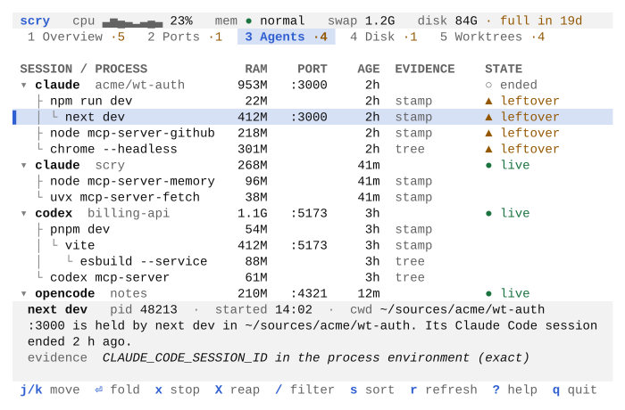
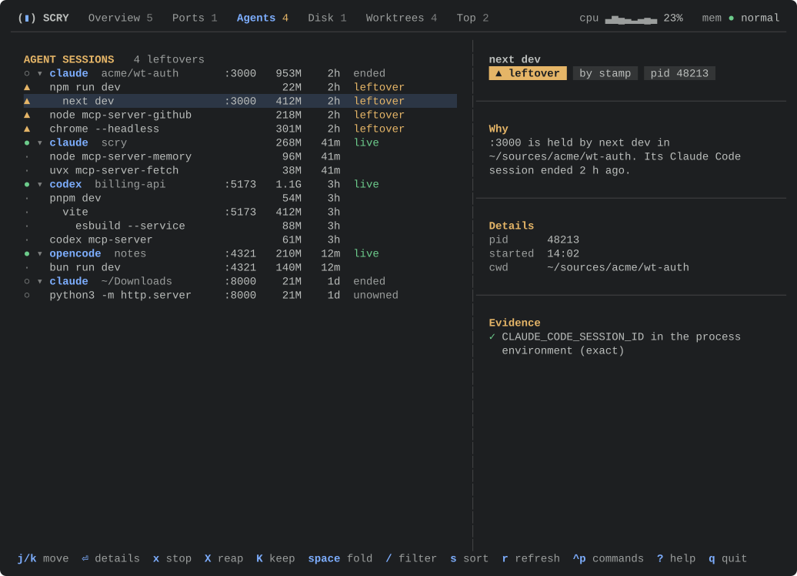
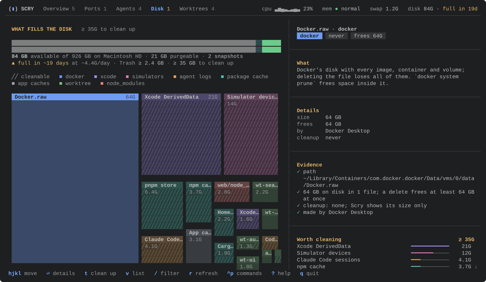
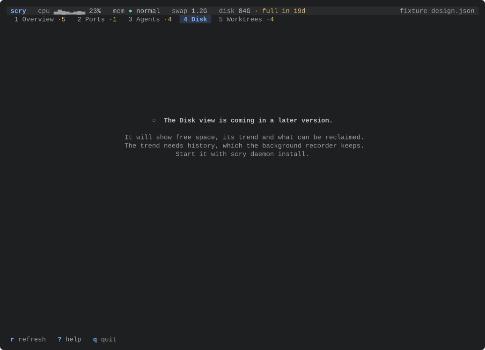
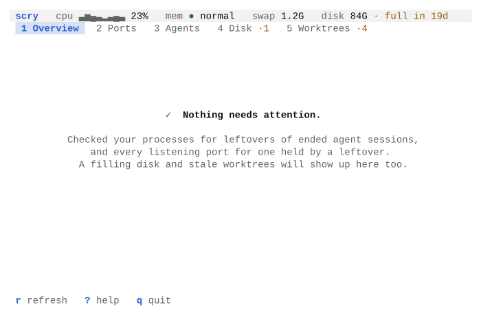
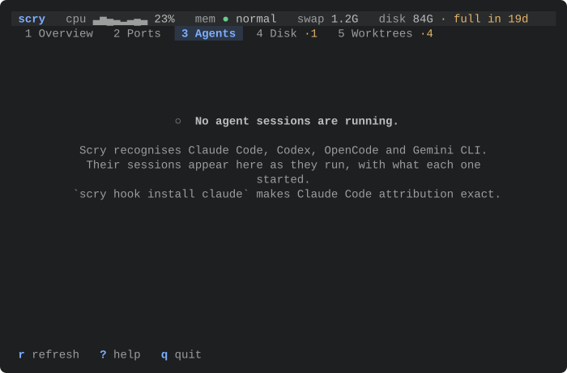
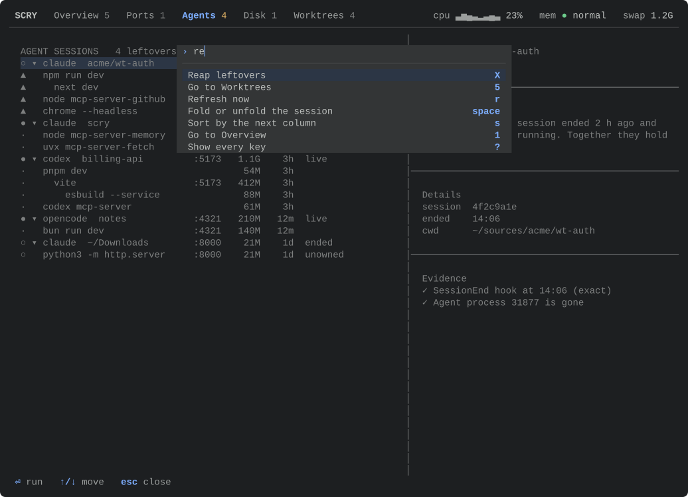

# How the Scry TUI looks, and why

Scry's terminal UI was designed by rendering candidate looks to pictures and choosing
between them, not by argument. This page shows the comparison, the look that won, the
design system the views are built from, and how to rerun the pictures.

Every screen here is drawn from [`fixtures/design.json`](../fixtures/design.json), a
recorded set of view models with synthetic sessions, ports and processes. Nothing on these
pages comes from a real machine.

## The comparison

Two things were chosen this way: the palette, and the layout.

The palette: the same fixture, the Agents view (the densest one), in a light and a dark
terminal at 80×24, the smallest size Scry supports. A and B are both still drawn by the code,
in today's layout; C was a layout and a palette together.

| | Light | Dark |
|---|---|---|
| **A. Native**: the 16 ANSI colours only, reverse-video selection |  |  |
| **B. Tinted**: fixed hues per light and dark, neutrals mixed from the terminal's own colours |  |  |
| **C. Panels**: rounded boxes around list and detail, states as filled pills, ANSI colours |  |  |

The same at 120×40, and with the reap sheet open:
[native light](screens/compare/native-light-120x40.svg),
[native dark](screens/compare/native-dark-120x40.svg),
[tinted light](screens/compare/tinted-light-120x40.svg),
[tinted dark](screens/compare/tinted-dark-120x40.svg),
[panels light](screens/compare/panels-light-120x40.svg),
[panels dark](screens/compare/panels-dark-120x40.svg);
sheets:
[native](screens/compare/native-dark-sheet.svg),
[tinted](screens/compare/tinted-dark-sheet.svg),
[panels](screens/compare/panels-dark-sheet.svg).

The light terminal is macOS Terminal's default profile, "Basic". The dark one is Tomorrow
Night, a common dark palette. Basic is what a new Mac gives you, which is the point: an ANSI
look is only as good as the palette it lands in.

## The layout: D, Split

The first release drew a header band with the pulse, a tab bar, a table with column titles,
a cursor bar (`▌`) and tree guides, and the detail on a tinted band under the list, beside
it only from 150 columns. Its pictures are at commit `ee8318b`.

D replaced it, modelled on [ghui](https://github.com/kitlangton/ghui)'s list and detail, and
for Disk on [disktree](https://github.com/tobi/disktree)'s treemap:

- **One header line and a rule.** `SCRY`, the views by name with their counts, the pulse on
  the right. The Overview shows the pulse as gauges instead.
- **Lists without column titles.** The list's name is the section title (`AGENT SESSIONS`,
  in the warn hue), with a note of what asks for something and, when sorted, what orders it
  (`by ram ↓`). Each row reads as a sentence: the state as a glyph in a gutter, the name,
  then numbers to the right and the state word last. Children are indented, without guides.
  Agents dropped its PID and evidence columns; both are in the pane.
- **The detail beside the list from 100 columns** (40 to 60 wide), behind a thin rule: the
  title in bold, the state and facts as filled chips, then sections set apart by rules: why
  the row is there, its details, the evidence, and on Disk what is worth cleaning. Under 100
  columns it sits under the list with the title, the chips and the sentence. `enter` opens it
  over the whole body, scrolled with `j k`.
- **The Overview opens with gauges**: CPU with its recent samples, memory pressure as three
  steps with the swap in use, the free disk with the volume as a bar and the forecast, and
  from 110 columns how many processes agent sessions started.
- **Disk opens as a treemap**: the volume as a bar, then every item sized by what it takes,
  coloured by kind and hatched (`╱`) where Scry can clean it up. The arrows move between
  tiles by where they are on screen; `v` shows the ranked list instead.
- **Navigation from ghui**: `ctrl-p` or `:` opens a palette of every command that applies
  here, found by typing; the mouse picks views, rows and tiles, a second click opens the
  detail, and the wheel scrolls.

D keeps B's palette and every contrast rule below. At 80×24 the Agents list shows 14 rows
where the old layout showed 12: the tab bar, the column titles and the rule above the footer
are gone, and the pane under the list keeps to its sentence.




## The palette: B, Tinted

**Light mode decided it.** In Terminal's Basic palette, ANSI yellow is `#999900` on white.
That is the colour of "leftover", the word Scry most needs you to read. Native's reverse-video
selection turns the selected row into a black bar and recolours the state word inside it.
Tinted's hues keep a contrast of 5:1 or more on white, Solarized light and dark, black,
Tomorrow Night and One Dark backgrounds, against 3:1 for that yellow. Its selection is a tint
of at least 1.3:1 against the background, and every hue keeps 3.7:1 or more on the tint, so
the state colours stay readable on the selected row.

**In dark mode A and B are close.** Tinted is calmer: a softer selection, and greys that
match the terminal.

**Tinted still follows the terminal.** Scry asks the terminal for its foreground and
background (OSC 10 and 11), then for its device attributes (DA1), only where the answer is
known to come at once: a local session (neither `SSH_CONNECTION` nor `SSH_TTY` set) in
Ghostty, iTerm2, Terminal, WezTerm or kitty, recognised by `TERM_PROGRAM`, or by `TERM` for
Ghostty and kitty. The list is a table in `theme.rs`. `SCRY_COLOR_QUERY=1` asks anywhere and
`SCRY_COLOR_QUERY=0` never asks. The question goes out after raw mode is on and before the
first key is read, through Scry's own non-blocking open of the terminal, and Scry reads until
the DA1 answer, which comes after the colours, for at most a second. Keys typed meanwhile
are handed to the event loop in order, and nothing is flushed. Only when the second passes
before the DA1 answer can the rest of an answer still come. For the next two seconds Scry
then picks it out of the keys, starting from where the cut answer stood. It holds keys that
could be part of an answer, and lets them through if the answer breaks off.

Everywhere else Scry asks nothing: inside tmux, which answers DA1 at once and sends no
colours, over ssh, and in a terminal not on the list. Light or dark then comes from
`COLORFGBG` when it is set, else from the macOS appearance (read from the global
preferences through CoreFoundation, without starting a process), else dark. The neutrals are
mixed from a stand-in pair: white and black for light, `#1c1c1c` and `#d0d0d0` for dark. A
terminal whose theme is the other way round from the guess, a light profile in dark mode
say, gets greys tuned for the wrong side; `SCRY_COLOR_QUERY=1` puts that right in a terminal
that answers.

The neutrals (text, muted, faint, rules, raised surfaces) are mixed from the two
colours, so a Solarized or a pure black terminal gets matching greys. Each is then pushed
further from the background until it reaches its minimum contrast on the background, the
overlays and the selection: 6:1 for text, 4.5:1 for muted labels, 3:1 for faint marks. The
accent and the four state hues are fixed, one set for light backgrounds and one for dark.
The selection is the background mixed with that accent until it stands 1.3:1 apart. A
chip's text is the terminal's background on the hue, and each of the eight disk kinds has
its own pair of hues; both keep 4.5:1 in every theme above, and so does a tile's label on
its bar, whose hue is held back until it does.


**C was rejected.** At 80×24 its borders cost three list rows (11 instead of 14). The box
titles repeat the tab bar. Filled pills shout, and the quiet pill (reverse video) reads like
an error. Panels was removed from the code after the spike; its pictures come from commit
`2d39a74`, where `scripts/shots.sh` still renders it, and show that commit's layout.

This departs on purpose from one line in the original plan ("the palette is the terminal's
own 16 ANSI colours"). The goal behind that line, following the user's theme in light and
dark, holds. Without truecolor Scry falls back to exactly that principle, below.

## How it degrades

| Terminal | What Scry draws |
|---|---|
| `COLORTERM=truecolor` or `24bit`, a local terminal on the list (or `SCRY_COLOR_QUERY=1`), and it reports its colours | Tinted, from those colours |
| `COLORTERM=truecolor` or `24bit` anywhere else: tmux, ssh, VS Code, a terminal not on the list, or one that sends no colours | Tinted, from the light or dark stand-in pair |
| `COLORTERM` unset or anything else | Native: the 16 ANSI colours, so the user's theme picks every hue. Nothing is asked |
| `NO_COLOR` set | No colour at all: bold, dim and reverse video. Every state is still a glyph and a word |


## Every view in the chosen look

| View | Light 80×24 | Dark 80×24 | Light 120×40 | Dark 120×40 |
|---|---|---|---|---|
| Overview | [svg](screens/overview-light-80x24.svg) | [svg](screens/overview-dark-80x24.svg) | [svg](screens/overview-light-120x40.svg) | [svg](screens/overview-dark-120x40.svg) |
| Ports | [svg](screens/ports-light-80x24.svg) | [svg](screens/ports-dark-80x24.svg) | [svg](screens/ports-light-120x40.svg) | [svg](screens/ports-dark-120x40.svg) |
| Agents | [svg](screens/agents-light-80x24.svg) | [svg](screens/agents-dark-80x24.svg) | [svg](screens/agents-light-120x40.svg) | [svg](screens/agents-dark-120x40.svg) |
| Disk | [svg](screens/disk-light-80x24.svg) | [svg](screens/disk-dark-80x24.svg) | [svg](screens/disk-light-120x40.svg) | [svg](screens/disk-dark-120x40.svg) |
| Worktrees | [svg](screens/worktrees-light-80x24.svg) | [svg](screens/worktrees-dark-80x24.svg) | [svg](screens/worktrees-light-120x40.svg) | [svg](screens/worktrees-dark-120x40.svg) |

The Disk and Worktrees fixture rows are synthetic. Disk's cleanup sheets, a delete that
waits for the item's name and a worktree going to the Trash:
[delete light](screens/disk-delete-light.svg),
[delete dark](screens/disk-delete-dark.svg),
[trash light](screens/disk-trash-light.svg),
[trash dark](screens/disk-trash-dark.svg).



On a first run with nothing to report, a view says what it checked and how to fill it:
the Overview names the checks behind its all-clear, and an empty Agents view names the
agents Scry recognises and the hook that makes attribution exact.

| Overview | Agents |
|---|---|
|  |  |

From 100 columns the detail pane is beside the list; at 150:
[agents light](screens/agents-light-150x40.svg),
[agents dark](screens/agents-dark-150x40.svg),
[ports light](screens/ports-light-150x40.svg),
[ports dark](screens/ports-dark-150x40.svg),
[overview dark](screens/overview-dark-150x40.svg),
[ANSI dark](screens/ansi-dark-150x40.svg).

Disk as a list ([light](screens/disk-list-light-120x40.svg),
[dark](screens/disk-list-dark-120x40.svg)), the detail opened with `enter`
([light](screens/detail-light.svg), [dark](screens/detail-dark.svg)), and the command
palette ([light](screens/palette-light.svg), [dark](screens/palette-dark.svg)):



States and overlays, each in [light](screens/state-loading-light.svg) and dark:

| Loading | Failed | Empty |
|---|---|---|
|  |  |  |

| Reap sheet | Filter | Help |
|---|---|---|
|  |  |  |

A reap sheet longer than the screen, at 80×24, at the top and scrolled to the end:

| Top | End |
|---|---|
|  |  |

The same sheet [at 150×40](screens/sheet-long-dark-150x40.svg), and
[in the ANSI look](screens/ansi-sheet-long-dark.svg), where it sits under the one rule.

## The design system

### Tokens

Components ask the theme for a role, never for a colour. A look is one constructor in
`crates/scry/src/tui/theme.rs`.

| Token | Used for |
|---|---|
| `text`, `strong` | Body text; the name, the pane's title, command names |
| `muted` | Labels, context, notes, fold counts, the fixture name or refresh spinner, the sparkline |
| `faint` | Dots in the gutter, separators, the used part of the volume and whatever an overlay covers |
| `accent` | The open view, a session's name, the palette's prompt |
| `heading` | Gauge labels, the overlays' column titles |
| `title` | A list's name and each section of the pane, in the warn hue, bold |
| `ok`, `info`, `warn`, `danger` | State glyphs and words, gauges and the volume bar |
| `selection` | The selected row's tint |
| `chip(tone)`, `kind_chip(kind)` | Filled chips in the pane: a hue behind the terminal's background colour; reverse video without truecolor |
| `kind(kind)`, `tile(kind, selected)` | A disk kind's swatch, and a treemap tile's label bar, fill and hatch |
| `raised` | The sheets, the help card, the palette and quiet chips, a step from the background |
| `border` | Rules, and the edges of overlays in the ANSI look |
| `key`, `matched` | Keys in hints, filter hits (the accent, underlined) |
| `chrome` | How overlays are edged: lines (Native) or their fill (Tinted) |
| `motion` | The background, foreground and glow colours fades run between; truecolor only |

### State is a glyph and a word

Each state in `scry_core::view::State` has a word and a tone. The tone picks the colour and
the glyph, so nothing depends on colour alone.

| Tone | Glyph | States |
|---|---|---|
| ok | ● | live |
| info | ◆ | kept |
| warn | ▲ | leftover, stale, filling |
| danger | ✕ | full |
| quiet | ○ | ended, unowned, system |

### Components

All in `crates/scry/src/tui/kit/`:

- `chrome`: the header line (`SCRY`, the views with their counts, and on the right the
  pulse, which drops segments from the right when space runs out, then the activity), rules,
  the section title over a list, and the footer. The footer's left side shows the filter
  while it is typed, else a toast, else the filter that is applied, and then the keys that do
  something on this view as it is. When they do not fit, the view's later keys give way
  first; refresh, commands, help and quit stay.
- `table`: a flattened tree as a list without column titles. The state is a glyph in a
  two-column gutter (`·` for a row with none), a parent's name is in the accent with `▾ ▸`
  and a fold count, children are indented, and any cell shows the characters the filter
  matched. Numbers align right, cut text ends in `…`, and columns hide below a set width.
  Text columns are as wide as their longest cell, up to 48 columns, and the spare width stays
  at the right, so a name sits next to its numbers. Widths and number alignment come from
  every row of the view, so a filter or a fold never moves a column. Widths count display
  columns and cuts fall between graphemes, so CJK, accents and emoji line up. The list keeps
  the cursor in view and never stays scrolled past rows that would fit.
- `detail`: the pane. Beside the list, or over the whole body after `enter`: the title, the
  chips (the state, then what the view adds: evidence and pid, a disk item's kind, cleanup
  and what it frees), and sections under full-width rules: the sentence, the details, the
  evidence, and on Disk a ranking of what is worth cleaning with a bar in each kind's hue.
  An arrow at its edge says there is more above or below. Under a list narrower than 100
  columns: the title, the chips and the sentence, right under the last row behind a rule,
  at most 6 rows (4 on a short screen).
- `gauges`: the Overview's CPU, memory, disk and agent gauges, each a label, a figure three
  rows tall in half blocks, a graph two rows tall and a caption, side by side with rules
  between.
- `treemap`: the volume as a bar two rows tall (used, purgeable, free) with the space and the
  forecast under it; the legend of kinds; and the items as a squarified treemap laid out on
  doubled rows, so tiles look square on screen. Each tile has a label bar with the name and
  its size, a tinted fill, and a hatch where Scry can clean it up; the selected one is drawn
  in its kind's full hue. Moving between tiles works as a browser moves focus: the tiles
  lined up with the selected one first, then the nearest edge, then the least offset.
- `overlay`: the confirmation sheet, which rises from the bottom and lists every target with
  pid, age, command, session, evidence and the memory it frees; and the help card. Both sit
  on the `raised` surface, and what they cover fades to the faint ink. In the tinted look the
  fill is the edge, because a line drawn through the edge cells leaves half a cell of fill
  outside it; the help card keeps a margin of plain background around it. When the targets do
  not fit, the sheet scrolls with `j k`, its last line says how many are above and below, and
  the title and total stay in view. It keeps its place through a resize. A sheet that would
  leave fewer than three rows of the list above it covers the whole body. Only the command
  name in each row is bold. The command palette sits near the top: what was typed, then the
  commands that match with their keys.
- The cleanup sheet, in `overlay`: rises like the stop sheet and names the action, the
  folder as the list shows it, its size and at least what it frees, and for a worktree its
  repo. A delete waits for the item's name to be typed into the sheet; enter does nothing
  until it matches.
- `states`: empty, loading, unavailable and failed, each a glyph and a sentence. ✓ is kept
  for an all-clear, a view that read its source and found nothing to show. No rows matching
  the filter, and an Overview whose sources are not collected yet, get a neutral ○. Under
  the sentence a muted hint says what would fill the view on a first run: which folders
  Worktrees searched and where to change them, the command that starts Disk's history.
  The text wraps within 64 columns.

### Modes

The keys mean different things in each mode, so the mode is one value, not a set of flags:

| Mode | Keys |
|---|---|
| Normal | `j k ↑ ↓ g G` move, `⏎` details (on the Overview, go to the row), `space` fold a session, `h l` fold and unfold (`h` on a process goes to its parent), `1-5 tab` views, `/` filter, `esc` clear the filter, `s S` sort, `x` stop, `X` reap, `K` keep, `t` clean up (Disk and Worktrees), `v` treemap or list (Disk), `ctrl-p :` commands, `r` refresh, `?` help, `q` quit. On Disk's treemap `h j k l` and the arrows move by tile |
| Detail | `j k ↑ ↓ g G` and `ctrl-d ctrl-u` scroll, `esc ⏎ q` back to the list; every other key acts as in Normal, on the same row |
| Palette | type to find, `↑ ↓` or `ctrl-n ctrl-p` move, `⏎` run, `esc` close |
| Filter | type to filter, `⏎` keep, `esc` clear, `↑ ↓` move |
| Sheet | `⏎` confirm, `j k` scroll, `esc` cancel |
| Clean | `⏎` or `y` confirm, `esc` cancel; for a delete, type the name, then `⏎` |
| Help | `esc ? q` close |

The mouse works in Normal, Filter and Detail: a click picks a view, a row or a tile, a click
on the picked one opens it as `⏎` would, and the wheel moves the selection, or scrolls the
detail or a sheet. Mouse reporting holds the terminal's own selection; hold `shift` (in
iTerm2 and Ghostty, `option` in Terminal) to select text.

Only `q` and ctrl-c quit, so one `esc` too many never closes Scry. In the filter, alt chords
are ignored rather than typed. SIGTERM and SIGINT put the terminal back and exit with 128 plus
the signal, 143 for SIGTERM, as shells report a process that a signal ended. SIGHUP does the
same at once. Every change of terminal modes takes a lock that the signal handler holds from
its restore until the exit, so no mode change can undo the restore.

The filter is fuzzy with smart case. Each word of it matches inside one column on screen, so
letters scattered across a row never make a match, and the matched characters are
highlighted where they are. The selection moves to the first row that matches, not to a
session kept above it for context. Folds are off while a filter is applied, and `space`
says so rather than changing a fold you cannot see.

`s` walks the columns on screen only, and the section title names the one in effect. When a
resize hides the sorted column, the list goes back to its natural order until the column
returns. STATE sorts by what it asks of you:
full, then leftover, stale and filling, then kept, the quiet states and live last. Rows
without a value come last whichever way a column sorts.

Stopping and reaping are not wired to signals yet; confirming a sheet says so. Cleanup
is: `t` on an item opens its sheet when the item allows an action, and otherwise says in
the footer why not (the command to run yourself, "shows its size only", or that cleanup
is off). A confirmed cleanup runs off the UI thread; the footer says "Cleaning up…", then
"Moved 1.3 GB to Trash; the Trash holds at least 3.7 GB. Empty it to free the space." or
why nothing was done, and the views read the disk again.

### Motion

Two effects, both through `tachyonfx` 0.25 (built on `ratatui-core` 0.1, the core of
ratatui 0.30): the sheet fades in over 180 ms, and a row that is new or whose state changed
glows for 900 ms after a rescan or a live update. Numbers that move on every sample, such as
RAM, do not make a row glow. The effects run only in truecolor, because a fade between a
theme's named colours has no right answer. The loop draws when something changed and, while
an effect runs, every 16 ms; then it goes back to waiting for input.

### Refresh

Live data comes from two readers off the UI thread. Process snapshots, which carry the
ports, are read at start and then every `[tui] refresh_secs` (5 s by default, 1 to 60, 0
for only on `r`). Worktrees and the disk are read together when either view opens, from
the size cache in Scry's store: the catalog's items show at once with their cached
sizes, the worktrees once git has read them, and then the parts that FSEvents says
changed are walked again. A size shown while its folder is read again ends in `…`.
Walking everything once took about 50 s on the reference Mac, so this reading never runs
on a timer: coming back to the view reads it again when the last reading is over 2
minutes old. `r` asks for a process reading at once, and on Disk or Worktrees for a disk
reading too; the footer says "Refreshed." when it lands.

The header shows no clock. Its right end is empty while nothing is read, and holds a muted
braille spinner (`⠋⠙⠹…`, 10 frames a second) while a reading the view waits on is in
flight: one that `r` asked for at once, an automatic one only after 300 ms, so a quick
refresh (about 70 ms on the reference Mac) never blinks. A reading past one second says
what it is doing beside the spinner: "refreshing…", or on Disk and Worktrees
"reading the disk…", "reading worktrees…" and "measuring sizes…". A fixture shows its name there instead.

A reading that changes nothing on screen draws nothing. A new board is compared with the
old by what the view shows, the header pulse, the tab counts and each row's text and
detail, not by the numbers under them, so ages advance when their text does ("41m" to
"42m") rather than on every refresh, and nothing glows. The loop draws when something
shown changed, when the spinner turns, or while an effect runs, not on a clock.

## Data shapes

Plain data in `scry-core` (no terminal types), so the planned menu bar app can draw the same
values:

- `Board`: every view model at one moment: `pulse: Option<Pulse>`, `overview: Overview`,
  `ports: Load<Vec<PortRow>>`, `agents: Load<Vec<AgentRow>>`,
  `worktrees: Load<WorktreeList>`, `disk: Load<DiskList>`. A recorded board is a design
  fixture: `scry tui --fixture fixtures/design.json`.
- `DiskList`: free space, the forecast, the Trash, and the items ranked by what deleting
  them frees. Each `DiskItem` carries what it allows (`Allows`: trash, delete, prune,
  command, never, or off) and, when that is an action, the exact `Plan` its sheet shows.
- `WorktreeList`: the worktree rows, the folders searched, the config file that sets them,
  and `sizing` while sizes are still measured.
- `Load<T>`: `Loading`, `Unavailable(reason)`, `Failed(reason)` or `Ready(T)`. Every view
  draws all four.
- `AgentRow`: one line of the session tree, flattened depth first with a `depth`, so the
  same rows work as a table in any skin.
- `Detail`: title, facts, one sentence, evidence lines. Evidence states facts, never what to
  press. `Target`: what an action would touch.

On the TUI side, a view turns its model into `Row`s (id, depth, cells, detail, chips, stop
target, jump target). Each view keeps a `ViewState`: the selected row id, filter text, sort and the
set of folded rows.

## Adding or filling a view

Each view is one file in `crates/scry/src/tui/views/` that fills a `ViewDef`: its title and
note, the pane's heading and ranking, its columns, a function from `Board` to rows, its empty
text, its tab badge, its key hints and what `X` reaps. `views/mod.rs` lists them in `VIEWS`,
one line each; all five are registered already. A view's model lives in
`scry-core/src/view/` with a field on `Board`; `views::disk_lines` and `views::empty` name
the views with lines or an empty text that only the board knows. The palette's commands are
one table in `app.rs`, `COMMANDS`, each with the key it presses and when it applies.

## Rerunning the pictures and the numbers

```sh
cargo run -p scry --example shots                 # SVGs into docs/screens
scripts/shots.sh                                  # the same, plus PNGs into target/shots
cargo run --release -p scry --example frames      # frame times per view at 120×40
scripts/pty-late-reply.py target/debug/scry       # the colour query against a played terminal
```

The shots example draws frames through ratatui's `TestBackend` and writes each cell's
foreground, background and bold, dim, italic, reverse, underline and strikethrough as SVG.
Named colours map through the palettes above, truecolor passes through, and the text uses a
monospace stack (`ui-monospace, SF Mono, Menlo, Consolas, Liberation Mono`) so GitHub renders
it with a local font. PNGs come from `rsvg-convert` (`brew install librsvg`).

`scripts/pty-smoke.sh` runs `pty-late-reply.py` after its own checks. It plays a terminal on
a bare pty, because tmux answers DA1 at once and sends no colours, and Scry does not ask
inside tmux anyway. It answers 400 ms late, 1.5 s late, 1.5 s late with the ESC in a read of
its own, and across the one-second deadline; types a key while Scry waits; checks that a
terminal not on the list is not asked; and sends SIGTERM during the question.
