# How the Scry TUI looks, and why

Scry's terminal UI was designed by rendering candidate looks to pictures and choosing
between them, not by argument. This page shows the comparison, the look that won, the
design system the views are built from, and how to rerun the pictures.

Every screen here is drawn from [`fixtures/design.json`](../fixtures/design.json), a
recorded set of view models with synthetic sessions, ports and processes. Nothing on these
pages comes from a real machine.

## The comparison

Three looks, the same fixture, the Agents view (the densest one), in a light and a dark
terminal at 80×24, the smallest size Scry supports.

| | Light | Dark |
|---|---|---|
| **A. Native**: the 16 ANSI colours only, reverse-video selection, thin rules | 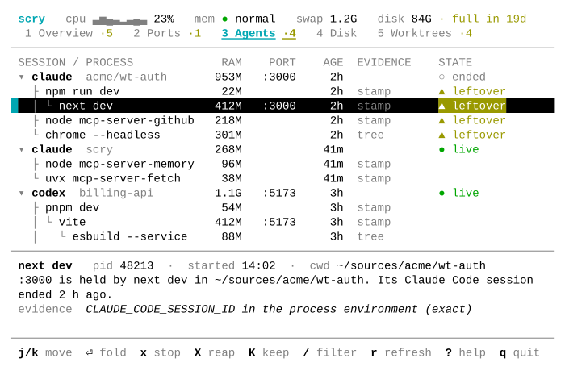 |  |
| **B. Tinted**: fixed hues per light and dark, neutrals mixed from the terminal's own colours, tinted bands instead of rules |  | 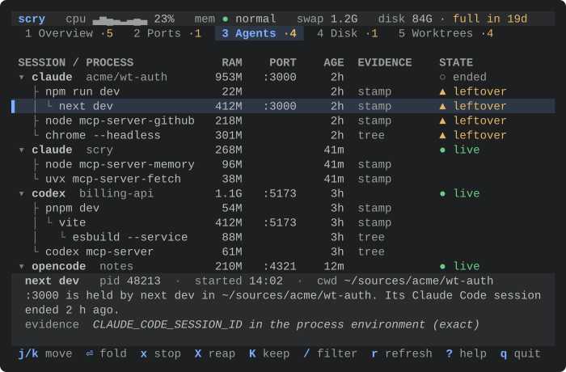 |
| **C. Panels**: rounded boxes around list and detail, states as filled pills, ANSI colours | 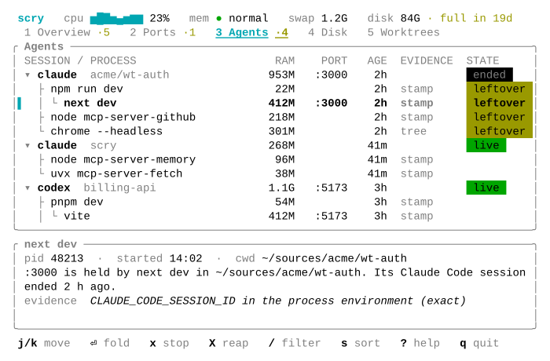 | 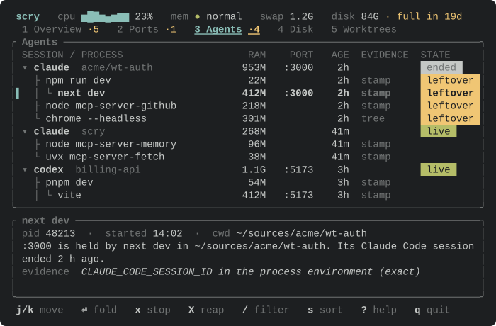 |

The same at 120×40, and with the reap sheet open:
[native light](screens/compare/native-light-120x40.svg),
[native dark](screens/compare/native-dark-120x40.svg),
[tinted light](screens/compare/tinted-light-120x40.svg),
[tinted dark](screens/compare/tinted-dark-120x40.svg),
[panels light](screens/compare/panels-light-120x40.svg),
[panels dark](screens/compare/panels-dark-120x40.svg);
sheets:
[native](screens/compare/native-dark-sheet.svg),
[tinted](screens/compare/tinted-dark-sheet.svg),
[panels](screens/compare/panels-dark-sheet.svg).

The light terminal is macOS Terminal's default profile, "Basic". The dark one is Tomorrow
Night, a common dark palette. Basic is what a new Mac gives you, which is the point: an ANSI
look is only as good as the palette it lands in.

## The pick: B, Tinted

**Light mode decided it.** In Terminal's Basic palette, ANSI yellow is `#999900` on white.
That is the colour of "leftover", the word Scry most needs you to read. Native's reverse-video
selection turns the selected row into a black bar and recolours the state word inside it.
Tinted's hues keep a contrast of 5:1 or more on white, Solarized light and dark, black,
Tomorrow Night and One Dark backgrounds, against 3:1 for that yellow. Its selection is a tint
of at least 1.3:1 against the background with an accent bar (`▌`) at its left, and every hue
keeps 3.7:1 or more on the tint, so the state colours stay readable on the selected row.

**In dark mode A and B are close.** Tinted is calmer: bands instead of rules, and a softer
selection.

**Tinted still follows the terminal.** Scry asks the terminal for its foreground and
background (OSC 10 and 11), then for its device attributes (DA1), only where the answer is
known to come at once: a local session (neither `SSH_CONNECTION` nor `SSH_TTY` set) in
Ghostty, iTerm2, Terminal, WezTerm or kitty, recognised by `TERM_PROGRAM`, or by `TERM` for
Ghostty and kitty. The list is a table in `theme.rs`. `SCRY_COLOR_QUERY=1` asks anywhere and
`SCRY_COLOR_QUERY=0` never asks. The question goes out after raw mode is on and before the
first key is read, through Scry's own non-blocking open of the terminal, and Scry reads until
the DA1 answer, which comes after the colours, for at most a second. Keys typed meanwhile
are handed to the event loop in order, and nothing is flushed. Only when the second passes
before the DA1 answer can the rest of an answer still come. For the next two seconds Scry
then picks it out of the keys, starting from where the cut answer stood. It holds keys that
could be part of an answer, and lets them through if the answer breaks off.

Everywhere else Scry asks nothing: inside tmux, which answers DA1 at once and sends no
colours, over ssh, and in a terminal not on the list. Light or dark then comes from
`COLORFGBG` when it is set, else from the macOS appearance (read from the global
preferences through CoreFoundation, without starting a process), else dark. The neutrals are
mixed from a stand-in pair: white and black for light, `#1c1c1c` and `#d0d0d0` for dark. A
terminal whose theme is the other way round from the guess, a light profile in dark mode
say, gets greys tuned for the wrong side; `SCRY_COLOR_QUERY=1` puts that right in a terminal
that answers.

The neutrals (text, muted, faint, rules, bands, raised surfaces) are mixed from the two
colours, so a Solarized or a pure black terminal gets matching greys. Each is then pushed
further from the background until it reaches its minimum contrast on the background, the
bands, the overlays and the selection: 6:1 for text, 4.5:1 for muted labels, 3:1 for faint
marks. The accent and the four state hues are fixed, one set for light backgrounds and one
for dark. The selection is the background mixed with that accent until it stands 1.3:1
apart.

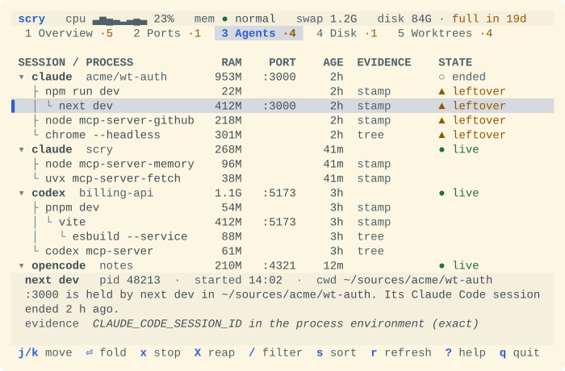

**C was rejected.** At 80×24 its borders cost three list rows (11 instead of 14). The box
titles repeat the tab bar. Filled pills shout, and the quiet pill (reverse video) reads like
an error. Panels was removed from the code after the spike; its pictures come from commit
`2d39a74`, where `scripts/shots.sh` still renders it, and show that commit's layout.

This departs on purpose from one line in PLAN.md section 2 ("the palette is the terminal's
own 16 ANSI colours"). The goal behind that line, following the user's theme in light and
dark, holds. Without truecolor Scry falls back to exactly that principle, below.

## How it degrades

| Terminal | What Scry draws |
|---|---|
| `COLORTERM=truecolor` or `24bit`, a local terminal on the list (or `SCRY_COLOR_QUERY=1`), and it reports its colours | Tinted, from those colours |
| `COLORTERM=truecolor` or `24bit` anywhere else: tmux, ssh, VS Code, a terminal not on the list, or one that sends no colours | Tinted, from the light or dark stand-in pair |
| `COLORTERM` unset or anything else | Native: the 16 ANSI colours, so the user's theme picks every hue. Nothing is asked |
| `NO_COLOR` set | No colour at all: bold, dim and reverse video. Every state is still a glyph and a word |


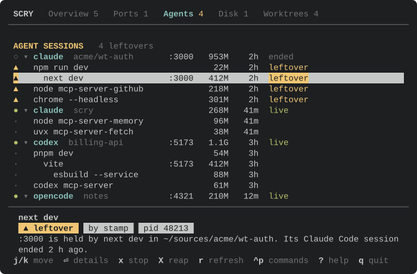
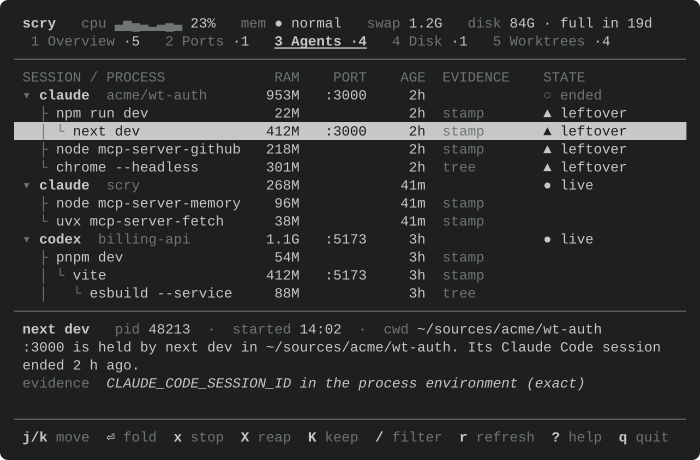

## Every view in the chosen look

| View | Light 80×24 | Dark 80×24 | Light 120×40 | Dark 120×40 |
|---|---|---|---|---|
| Overview | [svg](screens/overview-light-80x24.svg) | [svg](screens/overview-dark-80x24.svg) | [svg](screens/overview-light-120x40.svg) | [svg](screens/overview-dark-120x40.svg) |
| Ports | [svg](screens/ports-light-80x24.svg) | [svg](screens/ports-dark-80x24.svg) | [svg](screens/ports-light-120x40.svg) | [svg](screens/ports-dark-120x40.svg) |
| Agents | [svg](screens/agents-light-80x24.svg) | [svg](screens/agents-dark-80x24.svg) | [svg](screens/agents-light-120x40.svg) | [svg](screens/agents-dark-120x40.svg) |
| Disk | [svg](screens/disk-light-80x24.svg) | [svg](screens/disk-dark-80x24.svg) | [svg](screens/disk-light-120x40.svg) | [svg](screens/disk-dark-120x40.svg) |
| Worktrees | [svg](screens/worktrees-light-80x24.svg) | [svg](screens/worktrees-dark-80x24.svg) | [svg](screens/worktrees-light-120x40.svg) | [svg](screens/worktrees-dark-120x40.svg) |

Disk and Worktrees are not collected yet, so they show their "not built yet" state.

From 150 columns the detail pane moves beside the list, which keeps 96 columns:
[agents light](screens/agents-light-150x40.svg),
[agents dark](screens/agents-dark-150x40.svg),
[ports light](screens/ports-light-150x40.svg),
[ports dark](screens/ports-dark-150x40.svg),
[ANSI dark](screens/ansi-dark-150x40.svg).

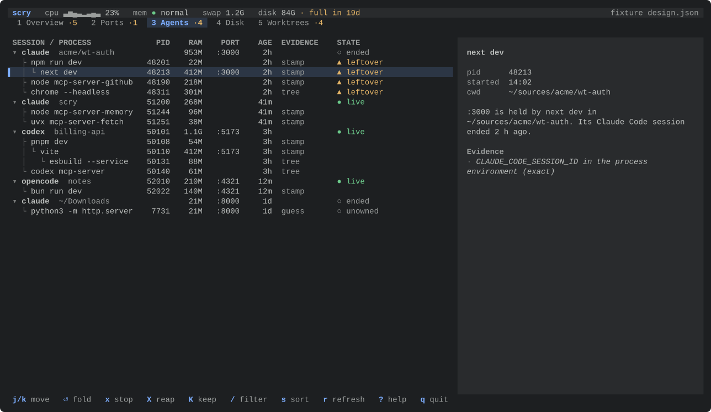

States and overlays, each in [light](screens/state-loading-light.svg) and dark:

| Loading | Failed | Empty |
|---|---|---|
| 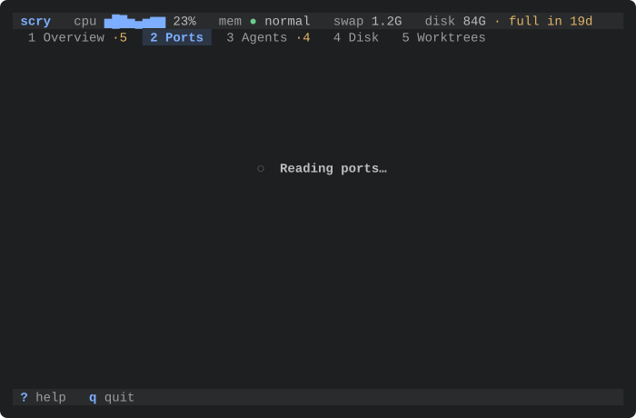 | 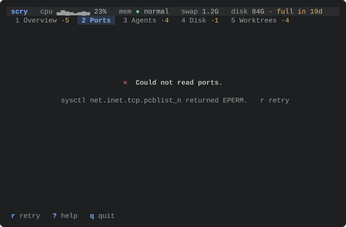 | 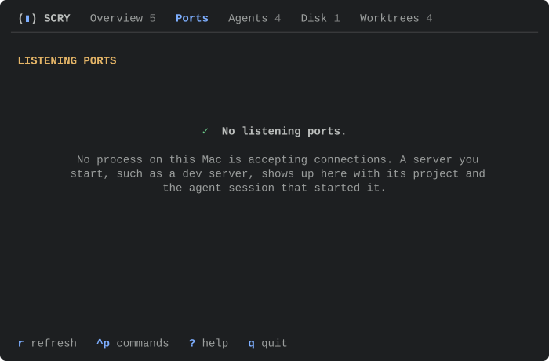 |

| Reap sheet | Filter | Help |
|---|---|---|
| 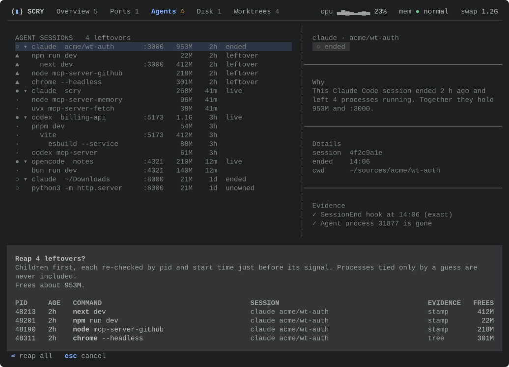 | 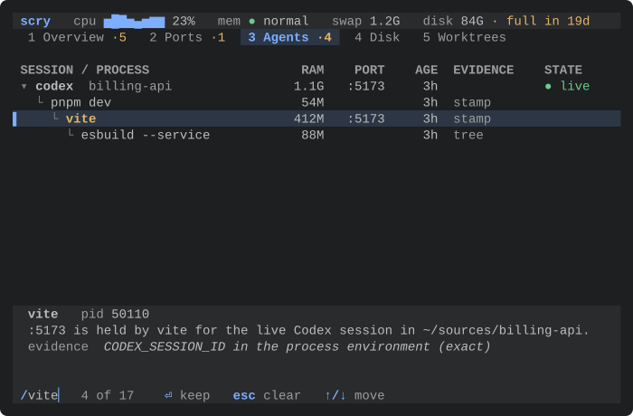 | 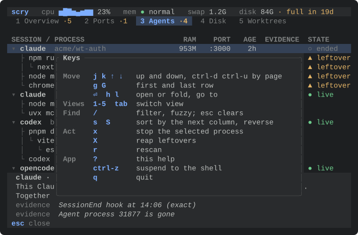 |

A reap sheet longer than the screen, at 80×24, at the top and scrolled to the end:

| Top | End |
|---|---|
| 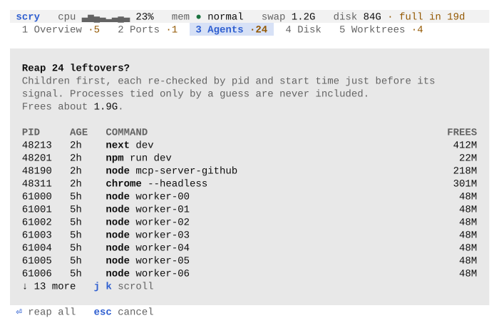 | 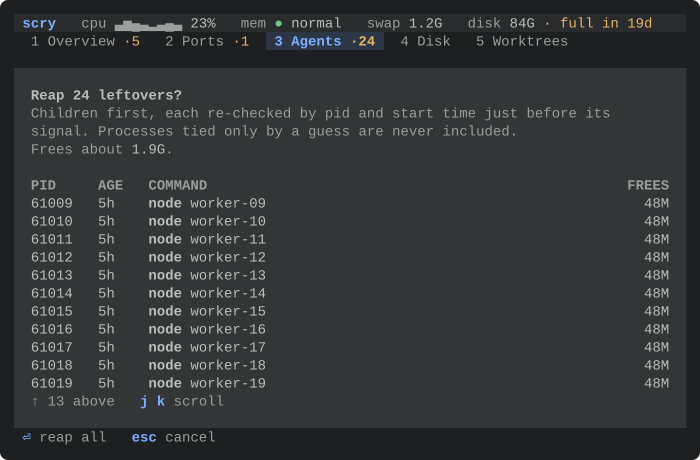 |

The same sheet [at 150×40](screens/sheet-long-dark-150x40.svg), and
[in the ANSI look](screens/ansi-sheet-long-dark.svg), where it sits under the one rule.

## The design system

### Tokens

Components ask the theme for a role, never for a colour. A look is one constructor in
`crates/scry/src/tui/theme.rs`.

| Token | Used for |
|---|---|
| `text`, `strong` | Body text; titles, session names and command names |
| `muted` | Labels, context, evidence words, fold counts, the data source, the sparkline |
| `faint` | Tree guides, separators and whatever an overlay covers: nothing you need to read |
| `accent` | The name, the sort arrow |
| `heading` | Column titles |
| `ok`, `info`, `warn`, `danger` | State glyphs and words |
| `selection`, `cursor` | The selected row's tint, and the bar left of it |
| `surface` | Bands behind the header and the detail pane |
| `raised` | The sheet and the help card, a step further from the background than the bands |
| `border` | Rules, and the edges of overlays in the ANSI look |
| `key`, `matched`, `tab_active` | Keys in hints, filter hits (the accent, underlined), the open tab |
| `chrome` | `Rules` (Native) or `Bands` (Tinted) |
| `motion` | The background, foreground and glow colours fades run between; truecolor only |

### State is a glyph and a word

Each state in `scry_core::view::State` has a word and a tone. The tone picks the colour and
the glyph, so nothing depends on colour alone.

| Tone | Glyph | States |
|---|---|---|
| ok | ● | live |
| info | ◆ | kept |
| warn | ▲ | leftover, stale, filling |
| danger | ✕ | full |
| quiet | ○ | ended, unowned, system |

### Components

All in `crates/scry/src/tui/kit/`:

- `chrome`: the header (the name, then a slot for the pulse strip that drops segments from
  the right when space runs out), the tab bar with attention counts, the footer, rules. The
  footer sits on the plain background, under the detail band rather than in it. Its left
  side shows the filter while it is typed, else a toast, else the filter that is applied,
  and then the keys that do something on this view as it is.
- `table`: a flattened tree as a table. Columns align across depths; the first column
  carries the tree glyphs (`▾ ▸ ├ └ │`) and a fold count, and any cell shows the characters
  the filter matched. Numbers align right, cut text ends in `…`, and columns hide below a set
  width. Text columns are as wide as their longest cell, up to 48 columns, and the spare width
  stays at the right, so a name sits next to its numbers. Widths and number alignment come
  from every row of the view, so a filter or a fold never moves a column. Every sortable
  column keeps room for ` ↓` or ` ↑` after its title, so the arrow never cuts it. Widths count
  display columns and cuts fall between graphemes, so CJK, accents and emoji line up. The list
  never stays scrolled past rows that would fit.
- `detail`: the selected row in one sentence, then the evidence. Under 150 columns it sits
  right under the list with facts on the title line, as tall as the tallest detail in the
  view (at most 7 rows, 5 on a short screen), so it keeps its height while the cursor moves.
  From 150 it is beside the list, with one fact per line.
- `overlay`: the confirmation sheet, which rises from the bottom and lists every target with
  pid, age, command, session, evidence and the memory it frees; and the help card. Both sit
  on the `raised` surface, and what they cover fades to the faint ink. In the tinted look the
  fill is the edge, because a line drawn through the edge cells leaves half a cell of fill
  outside it; the help card keeps a margin of plain background around it. When the targets do
  not fit, the sheet scrolls with `j k`, its last line says how many are above and below, and
  the title and total stay in view. It keeps its place through a resize. A sheet that would
  leave fewer than four rows of the list above it covers the whole body. Only the command
  name in each row is bold.
- `states`: empty, loading, unavailable and failed, each a glyph and a sentence. ✓ is kept
  for an all-clear, a view that read its source and found nothing to show. No rows matching
  the filter, and an Overview whose sources are not collected yet, get a neutral ○.

### Modes

The keys mean different things in each mode, so the mode is one value, not a set of flags:

| Mode | Keys |
|---|---|
| Normal | `j k ↑ ↓ g G` move, `⏎` fold a session or go to its row, `h l` fold and unfold (`h` on a process goes to its parent), `1-5 tab` views, `/` filter, `esc` clear the filter, `s S` sort, `x` stop, `X` reap, `r` rescan, `?` help, `q` quit |
| Filter | type to filter, `⏎` keep, `esc` clear, `↑ ↓` move |
| Sheet | `⏎` confirm, `j k` scroll, `esc` cancel |
| Help | `esc ? q` close |

Only `q` and ctrl-c quit, so one `esc` too many never closes Scry. In the filter, alt chords
are ignored rather than typed. SIGTERM and SIGINT put the terminal back and exit with 128 plus
the signal, 143 for SIGTERM, as shells report a process that a signal ended. SIGHUP does the
same at once. Every change of terminal modes takes a lock that the signal handler holds from
its restore until the exit, so no mode change can undo the restore.

The filter is fuzzy with smart case. Each word of it matches inside one column on screen, so
letters scattered across a row never make a match, and the matched characters are
highlighted where they are. The selection moves to the first row that matches, not to a
session kept above it for context. Folds are off while a filter is applied, and `⏎` says so
rather than changing a fold you cannot see.

`s` walks the columns on screen only. When a resize hides the sorted column, the list goes
back to its natural order until the column returns. STATE sorts by what it asks of you:
full, then leftover, stale and filling, then kept, the quiet states and live last. Rows
without a value come last whichever way a column sorts.

Stopping and reaping are not wired to signals yet; confirming a sheet says so.

### Motion

Two effects, both through `tachyonfx` 0.25 (built on `ratatui-core` 0.1, the core of
ratatui 0.30): the sheet fades in over 180 ms, and a row that is new or whose state changed
glows for 900 ms after a rescan or a live update. Numbers that move on every sample, such as
RAM, do not make a row glow. The effects run only in truecolor, because a fade between a
theme's named colours has no right answer. The loop draws when something changed and, while
an effect runs, every 16 ms; then it goes back to waiting for input.

## Data shapes

Plain data in `scry-core` (no terminal types), so the planned menu bar app can draw the same
values:

- `Board`: every view model at one moment: `pulse: Option<Pulse>`, `overview: Overview`,
  `ports: Load<Vec<PortRow>>`, `agents: Load<Vec<AgentRow>>`. A recorded board is a design
  fixture: `scry tui --fixture fixtures/design.json`.
- `Load<T>`: `Loading`, `Unavailable(reason)`, `Failed(reason)` or `Ready(T)`. Every view
  draws all four.
- `AgentRow`: one line of the session tree, flattened depth first with a `depth`, so the
  same rows work as a table in any skin.
- `Detail`: title, facts, one sentence, evidence lines. Evidence states facts, never what to
  press. `Target`: what an action would touch.

On the TUI side, a view turns its model into `Row`s (id, depth, cells, detail, stop target,
jump target). Each view keeps a `ViewState`: the selected row id, filter text, sort and the
set of folded rows.

## Adding or filling a view

Each view is one file in `crates/scry/src/tui/views/` that fills a `ViewDef`: its columns, a
function from `Board` to rows, its empty text, its tab badge, its key hints and what `X`
reaps. `views/mod.rs` lists them in `VIEWS`, one line each; all five are registered already.
To fill Disk, add its model in `scry-core/src/view/disk.rs` with a field on `Board`, then
replace the rows function in `views/disk.rs`.

## Rerunning the pictures and the numbers

```sh
cargo run -p scry --example shots                 # SVGs into docs/screens
scripts/shots.sh                                  # the same, plus PNGs into target/shots
cargo run --release -p scry --example frames      # frame times per view at 120×40
scripts/pty-late-reply.py target/debug/scry       # the colour query against a played terminal
```

The shots example draws frames through ratatui's `TestBackend` and writes each cell's
foreground, background and bold, dim, italic, reverse, underline and strikethrough as SVG.
Named colours map through the palettes above, truecolor passes through, and the text uses a
monospace stack (`ui-monospace, SF Mono, Menlo, Consolas, Liberation Mono`) so GitHub renders
it with a local font. PNGs come from `rsvg-convert` (`brew install librsvg`).

`scripts/pty-smoke.sh` runs `pty-late-reply.py` after its own checks. It plays a terminal on
a bare pty, because tmux answers DA1 at once and sends no colours, and Scry does not ask
inside tmux anyway. It answers 400 ms late, 1.5 s late, 1.5 s late with the ESC in a read of
its own, and across the one-second deadline; types a key while Scry waits; checks that a
terminal not on the list is not asked; and sends SIGTERM during the question.
